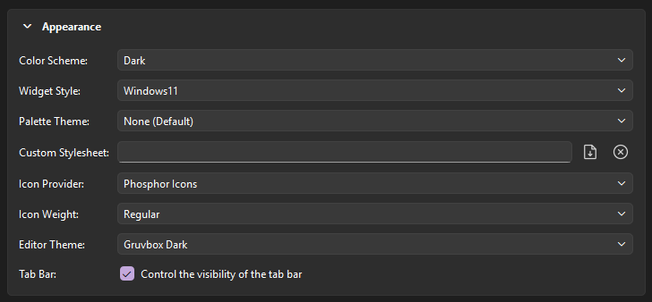
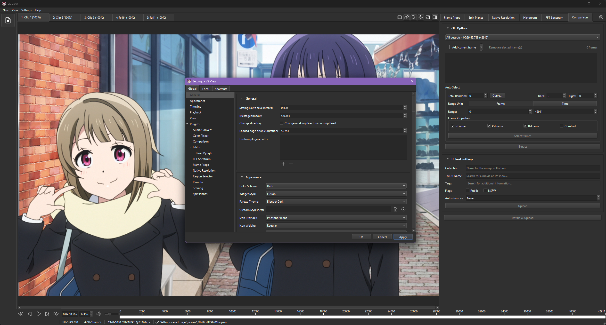
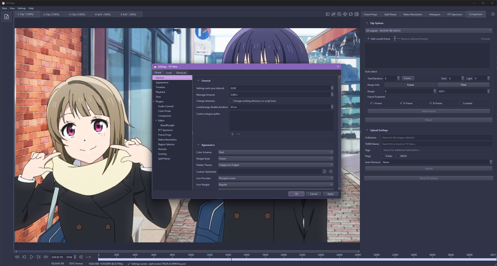
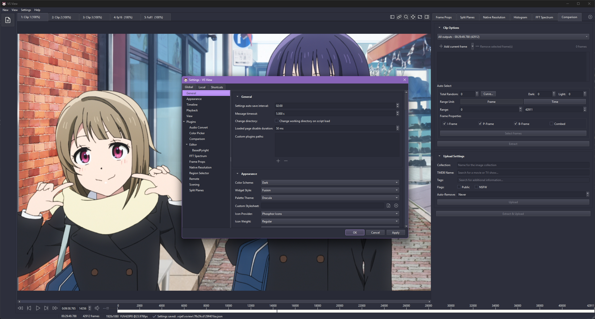
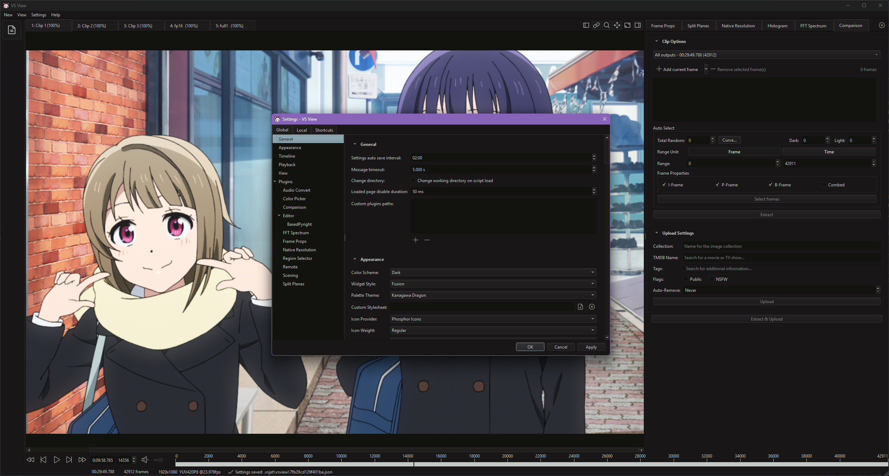
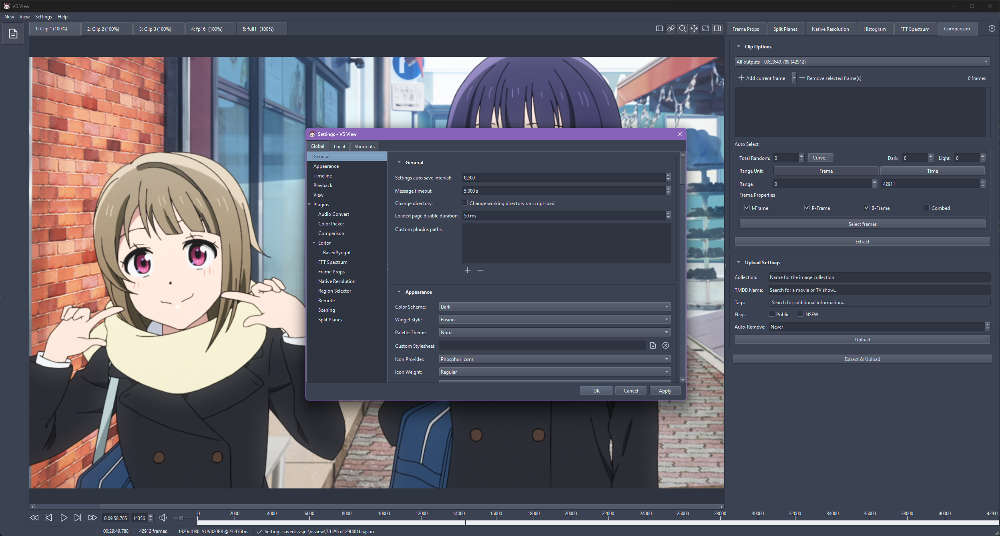

# Appearance

Appearance settings configure the application's theme, widget style, icon set, and custom styling.

## Settings Dialog

Open the appearance settings from the menu bar:

- **Settings** > **Appearance** (or press <kbd>Ctrl</kbd> + <kbd>,</kbd> / <kbd>Cmd</kbd> + <kbd>,</kbd>)

Settings are saved to `global_settings.json`.

<figure markdown="span">
    { .lightboxOn }
</figure>

---

## Options

### Color Scheme

Sets the OS-level color scheme.

-  **System Default**: Follows the operating system theme. 
-  **Light**: Forces light mode for window decorations and menus.
-  **Dark**: Forces dark mode for window decorations and menus.

Selecting **Light** or **Dark** filters the **Palette Theme** dropdown to matching themes.

---

### Widget Style

Sets the Qt widget style (e.g., `Fusion`, `Windows`).

!!! tip "Recommended Style"

    It is recommended to use the **Fusion** widget style when a custom widget style is selected,
    as it provides the most consistent appearance across all controls.

---

### Palette Theme

Applies a color palette across the UI. The examples below use the Fusion widget style.

=== "Stock (Default)"

    <figure markdown="span">
        { .lightboxOn }
        { .lightboxOn }
    </figure>

=== "Adwaita"

    <figure markdown="span">
        { .lightboxOn }
        { .lightboxOn }
    </figure>

=== "Atom One Dark"

    <figure markdown="span">
        { .lightboxOn }
    </figure>

=== "Ayu"

    <figure markdown="span">
        { .lightboxOn }
        { .lightboxOn }
    </figure>

=== "Ayu Mirage"

    <figure markdown="span">
        { .lightboxOn }
    </figure>

=== "Blender Dark"

    <figure markdown="span">
        { .lightboxOn }
    </figure>

=== "Breeze"

    <figure markdown="span">
        { .lightboxOn }
        { .lightboxOn }
    </figure>

=== "Catppuccin Frappé"

    <figure markdown="span">
        { .lightboxOn }
    </figure>

=== "Catppuccin Macchiato"

    <figure markdown="span">
        { .lightboxOn }
    </figure>

=== "Catppuccin Mocha"

    <figure markdown="span">
        { .lightboxOn }
        { .lightboxOn }
    </figure>

=== "Dracula"

    <figure markdown="span">
        { .lightboxOn }
    </figure>

=== "Everforest"

    <figure markdown="span">
        { .lightboxOn }
        { .lightboxOn }
    </figure>

=== "GitHub"

    <figure markdown="span">
        { .lightboxOn }
        { .lightboxOn }
    </figure>

=== "Gruvbox"

    <figure markdown="span">
        { .lightboxOn }
        { .lightboxOn }
    </figure>

=== "Kanagawa"

    <figure markdown="span">
        { .lightboxOn }
        { .lightboxOn }
    </figure>

=== "Kanagawa Dragon"

    <figure markdown="span">
        { .lightboxOn }
    </figure>

=== "Modern"

    <figure markdown="span">
        { .lightboxOn }
        { .lightboxOn }
    </figure>

=== "Monokai"

    <figure markdown="span">
        { .lightboxOn }
    </figure>

=== "Nord"

    <figure markdown="span">
        { .lightboxOn }
    </figure>

=== "One Dark Two"

    <figure markdown="span">
        { .lightboxOn }
    </figure>

=== "Rosé Pine"

    <figure markdown="span">
        { .lightboxOn }
        { .lightboxOn }
    </figure>

=== "Rosé Pine Moon"

    <figure markdown="span">
        { .lightboxOn }
    </figure>

=== "Solarized"

    <figure markdown="span">
        { .lightboxOn }
        { .lightboxOn }
    </figure>

=== "Tokyo Night"

    <figure markdown="span">
        { .lightboxOn }
        { .lightboxOn }
    </figure>

=== "Tokyo Night Storm"

    <figure markdown="span">
        { .lightboxOn }
    </figure>

---

### Custom Stylesheet

Applies a custom Qt Style Sheet (`.qss`) file on top of the active style and palette. Leave empty to disable.

---

### Icons

- **Icon Provider**: Selects the icon set.
- **Icon Weight**: Sets the stroke weight. Available weights depend on the selected provider.

---

## Custom Themes

Custom JSON themes can be placed in the `themes` directory inside the settings folder:

=== "Windows"

    ```text
    %LOCALAPPDATA%\vsview\themes\
    ```

=== "Linux"

    ```text
    ~/.config/vsview/themes/
    ```

=== "macOS"

    ```text
    ~/Library/Application Support/vsview/themes/
    ```

Run `vsview config path` to print your active settings directory.

### Format

```json title="custom_theme.json"
{
  "id": "custom_dark",
  "name": "Custom Dark",
  "scheme": "dark",
  "palette": {
    "base": "#1e1e2e",
    "mantle": "#181825",
    "crust": "#11111b",
    "surface0": "#313244",
    "surface1": "#45475a",
    "surface2": "#585b70",
    "overlay0": "#6c7086",
    "overlay1": "#7f849c",
    "overlay2": "#9399b2",
    "text": "#cdd6f4",
    "primary": "#89b4fa",
    "secondary": "#f5c2e7",
    "tertiary": "#94e2d5",
    "info": "#89dceb",
    "success": "#a6e3a1",
    "warning": "#f9e2af",
    "danger": "#f38ba8"
  }
}
```

Themes in this directory are loaded automatically on launch.
