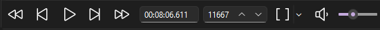
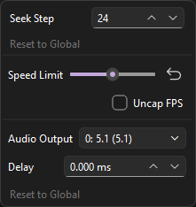
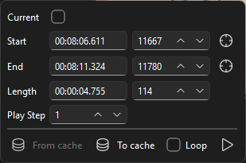
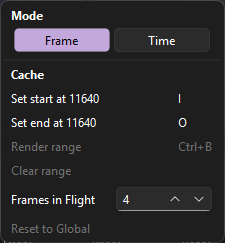

# Workspaces

**VSView** provides three built-in workspace types and two additional types through plugins:

- [**Script**](script.md): The primary environment for VapourSynth script development and previewing.
- [**File**](file.md): Preview media files directly, without a script.
- [**Quick**](quick-script.md): A basic integrated code editor for one-off testing and experiments.
- [**Editor**](editor.md): A Monaco-based editor for editing and executing VapourSynth scripts in VSView.
- [**Remote**](remote.md): Execute scripts remotely using [vsremote](https://github.com/Ichunjo/vs-remote).

All workspace types share the same core interface. The following sections describe behavior common to all of them, unless stated otherwise.

## Overview

When you load a script or file into a workspace, the interface is split into the following areas:

<figure markdown="span">
    { .lightboxOn }
</figure>

1. [**Workspace Tabs**](#1-workspace-tabs): Output tabs for the currently loaded script or file.
2. [**Frame Viewer**](#2-frame-viewer): Displays the current frame of the active output.
3. [**Playback Controls**](#3-playback-controls): Video and audio transport controls.
4. [**Timeline**](#4-timeline): Frame/time navigation for the active output.
5. [**Tool Docks**](#5-tool-docks): Plugin tools as dockable windows.
6. [**Tool Panels**](#6-tool-panels): Plugin tools as a tabbed side panel.
7. [**Status Bar**](#7-status-bar): Workspace state, media details, and runtime messages.

## 1. Workspace Tabs

Workspace tabs represent each available output from the currently loaded source.

- In **Script Workspace** and **Quick Script**, multiple outputs can be exposed and switched with tabs.
- In **File Workspace**, there is only one output tab.
- Selecting a tab updates the Frame Viewer, Timeline, and related tools to that output.

Additionally, the top-right corner of the tab bar contains buttons that control cross-tab behavior and panel visibility:
<figure markdown="span">
    { loading=lazy }
</figure>
- **Toggle Plugin Tool Docks**: Shows or hides the side Tool Docks area used by plugin tools.
- **Sync playhead**: Cycles through four modes for cross-tab timeline sync:
    - **Adaptive link**: Follows the current Timeline display mode (Time or Frame).
    - **Link by time**: Seeks all tabs to matching timestamps.
    - **Link by frame**: Seeks all tabs to matching frame numbers.
    - **Unlink**: Disables cross-tab playhead sync.
    The tooltip updates live to show the current active mode.
- **Sync zoom**: Links zoom level across outputs. Zooming in one tab applies the same zoom to all tabs.
- **Sync scroll**: Links pan/scroll position across outputs. Panning in one tab updates the viewed region in all tabs.
- **Autofit all views**: Automatically fits each output to the Frame Viewer viewport when enabled.
- **Toggle Plugin Tool Panel**: Shows or hides the side Tool Panel area used by plugin tools.

## 2. Frame Viewer

The Frame Viewer is the main preview area.
It displays the current frame from the active output tab.
Any playback action, play, scrub, or step forward/backward, refreshes this view in real time.

Right-clicking the displayed frame opens the following context menu:

<figure markdown="span">
    { loading=lazy }
</figure>

- **Zoom**: Zoom in and out. Also available via **++ctrl++** + **mouse wheel**.
- **Autofit**: Fits the current output to the Frame Viewer viewport.
- **Toggle SAR**: Toggles display of sample aspect ratio (SAR) correction for the current output (available only when SAR is not 1:1).
- **Save Current Image**: Opens a save dialog and writes the currently displayed frame to disk.
- **Copy Image to Clipboard**: Copies the currently displayed frame to the system clipboard.

## 3. Playback Controls

Playback Controls combine transport buttons, direct navigation fields, and audio controls.

<figure markdown="span">
    { loading=lazy }
</figure>

- **Seek N Backward / Forward**: Jumps by the configured seek step.
- **Seek 1 Backward / Forward**: Moves exactly one frame.
- **Play / Pause**: Starts or stops playback. During playback, seek buttons and time/frame fields are disabled, but Play / Pause remains available to stop playback.
- **Time field**: Seeks directly to a specific timestamp.
- **Frame field**: Seeks directly to a specific frame number.
- **Zone**: Plays the zone. Click its arrow to edit the zone (see [Zone Playback](#zone-playback)).
- **Mute + Volume**: Toggles mute and adjusts playback volume (enabled only when audio outputs are available).

Right-click the Playback Controls area for advanced settings:

<figure markdown="span">
    { loading=lazy }
</figure>

- **Seek Step**: Sets the N-frame jump size, with **Reset to Global** to restore the default value from the global settings.
- **Speed Limit**: Sets playback speed from 0.25x to 8.00x in 0.25x steps, with a reset button for 1.00x.
- **Uncap FPS**: Removes the speed limit.
- **Audio Output / Delay**: Selects audio output and adjusts sync delay (-10000 ms to +10000 ms), with **Reset to Global** to restore the default value from the global settings.

### Zone Playback

The zone button plays a range of frames. Click its arrow to open the zone editor:

<figure markdown="span">
    { loading=lazy }
</figure>

- **Current**: Plays **Length** frames from the current frame instead of a fixed range. Start and End then follow the current frame. With a negative **Play Step**, the zone ends at the current frame.
- **Start / End**: The first and last frames of the zone, as a time or a frame number. The crosshair button sets the bound to the current frame.
- **Length**: The number of frames in the zone, or their duration.
- **Play Step**: Plays every Nth frame. Negative values play the zone backwards, from its end.
- **From cache / To cache**: Copies the render cache range into the zone, or the zone into the render cache range.
- **Loop**: Plays the zone again from its start when it ends.

The zone is saved with the file and is shared by all outputs. The **Play Zone**, **Set Zone Start** and **Set Zone End** shortcuts have no default key. You can set them in the Settings Dialog.

## 4. Timeline

The Timeline provides precise navigation and visual reference markers for the active output.

- **Scrub with left-click + drag** on the timeline bar to seek interactively.
- **Hover preview**: Moving the mouse over the timeline shows the current hover position as frame/time; optional hover zoom can be enabled in timeline settings.
- **Fine seek**: Hold ++shift++ while hovering or dragging to move one frame at a time. The **Fine Seek Distance** timeline setting controls how many pixels the mouse moves for each frame.
- **Frame / Time display modes**: The scale and labels can be shown as frame numbers or timestamps.
- **Custom markers/notches**: Plugins and tools can add timeline markers (for example, bookmarks/keyframe-like markers), including optional ranges.
- **Notch seeking**: Jump to the notches shown on the timeline, from any plugin or tool.

    | Shortcut             | Action                                         |
    | :------------------- | :--------------------------------------------- |
    | ++ctrl+left++        | Seek to the previous notch or range boundary   |
    | ++ctrl+right++       | Seek to the next notch or range boundary       |
    | ++ctrl+shift+left++  | Seek to the previous notch, or start of range  |
    | ++ctrl+shift+right++ | Seek to the next notch, or start of range      |

    Each shortcut is customizable in the **Settings** menu.

Right-click the Timeline to switch display mode:

<figure markdown="span">
    { loading=lazy }
</figure>

### Mode

- **Frame**: Shows frame-based scale labels.
- **Time**: Shows timestamp-based scale labels.

### Render Cache

The **Cache** section in the Timeline menu controls the render cache for the current output.
The header shows the cache state and progress.

The actions are:

- **Set start** and **Set end**: Set the cache range to the frame you right-clicked.
- **Render range**: Renders the range in the background. It changes to **Pause render** or **Resume render** while a render is active.
- **Clear range**: Removes the range and deletes its cached frames.
- **Frames in Flight**: How many frames the render requests at once. Higher values use more memory. It applies only to the current script. **Reset to Global** restores the global value.

When the cache cannot be used, the actions are disabled. You can hover over one to see why.

The Timeline shows the cache range and cached frames as notches.

## 5. Tool Docks

Tool docks are movable plugin windows attached to the workspace layout.
You can drag a dock by its title bar to reposition it, dock it to an edge, stack it with other docks, or leave it floating as a separate window.

You can also toggle their visibility by using the **Toggle Plugin Tool Docks** button in the [Workspace Tabs](#1-workspace-tabs).

<figure markdown="span">
    <video controls width="100%" style="border-radius: 8px;">
        <source src="../../assets/tool_dock_showoff.mp4" type="video/mp4">
        Your browser does not support the video tag.
    </video>
</figure>

See [Plugins](../../plugins/overview.md) for more information.

## 6. Tool Panels

Tool Panels provide the same plugin tooling in a compact tabbed panel located on the right side of the workspace.

The panel is part of a **horizontal splitter**, which means you can click and drag the handle between the main content and the panel to resize it.

You can also hide the panel by dragging it to the edge or by using the **Toggle Plugin Tool Panel** button in the [Workspace Tabs](#1-workspace-tabs).

<figure markdown="span">
    <video controls width="100%" style="border-radius: 8px;">
        <source src="../../assets/tool_panel_showoff.mp4" type="video/mp4">
        Your browser does not support the video tag.
    </video>
</figure>

See [Plugins](../../plugins/overview.md) for more information.

## 7. Status Bar

The Status Bar shows live information about the active workspace / output

- Runtime/log messages for the workspace and its associated plugins.
- Contextual media information for the selected output.
