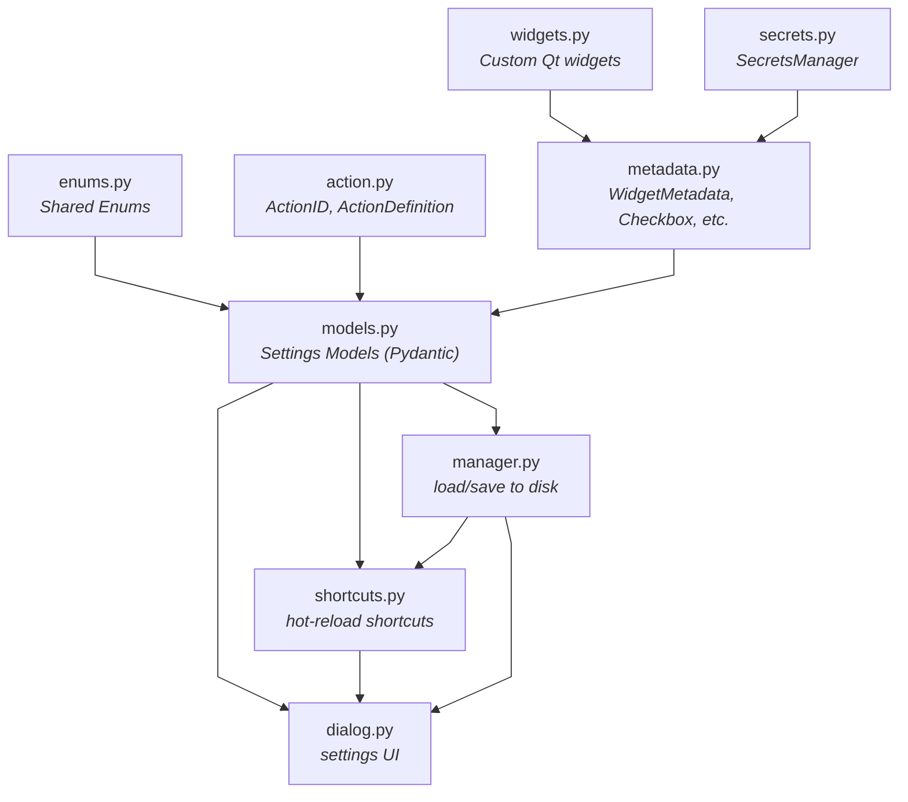

# Settings Module

- **Actions & Shortcuts**: Defined in `action.py` and managed by `ShortcutManager` in `shortcuts.py`.
- **Metadata**: UI metadata for settings (widgets, labels, transforms) is defined in `metadata.py`.
- **Models**: Pydantic models for settings storage are in `models.py`.
- **GUI**: The settings dialog is in `dialog.py`, while custom widgets are in `widgets.py`.

## Adding a Shortcut

### 1. Add ActionID (`action.py`)

```python
class ActionID(StrEnum):
    MY_ACTION = "scope.my_action", "My Action Label", "Ctrl+M"
    #             ↑ action_id        ↑ label            ↑ default key
```

### 2. Register for hot-reload

```python
from .settings import ActionID, ShortcutManager

# For QAction (e.g., menu items):
ShortcutManager.register_action(ActionID.MY_ACTION, my_action)

# For standalone shortcuts (global to a widget):
ShortcutManager.register_shortcut(ActionID.MY_ACTION, callback, parent_widget)
```

---

## Adding a Setting

Define a field with annotation and default value in a `BaseModel` in `models.py`.

```python
from .metadata import Checkbox


class GlobalSettings(BaseModel):
    __section__ = "General"

    my_feature: Annotated[bool, Checkbox(label="My Feature", text="Enable")] = False
```

---

## Widget Types

Defined in `metadata.py`:

| Type             | Annotation Example                                                                                                                                |
| ---------------- | ------------------------------------------------------------------------------------------------------------------------------------------------- |
| `Checkbox`       | `Annotated[bool, Checkbox(label="Enabled", text="Check me")]`                                                                                     |
| `LineEdit`       | `Annotated[str, LineEdit(label="Name", default_value="vsview")]`                                                                                  |
| `Dropdown`       | `Annotated[str, Dropdown(label="Mode", items=[("A", "a")])]`                                                                                      |
| `Spin`           | `Annotated[int, Spin(label="Size", min=0, max=100, suffix="px")]`                                                                                 |
| `DoubleSpin`     | `Annotated[float, DoubleSpin(label="Val", min=0, max=1)]`                                                                                         |
| `PlainTextEdit`  | `Annotated[list[float], PlainTextEdit(label="List", value_type=float)]`                                                                           |
| `ListEdit`       | `Annotated[list[str], ListEdit(label="Names", value_type=str)]`                                                                                   |
| `PathListEdit`   | `Annotated[list[str], PathListEdit(label="Folders")]`                                                                                             |
| `FilePicker`     | `Annotated[str \| None, FilePicker(label="Binary", file_filter="Programs (*.exe)")]`                                                              |
| `WidgetTimeEdit` | `Annotated[time, WidgetTimeEdit(label="Interval", display_format="mm:ss", to_ui=lambda t: QTime(0, t.minute, t.second), from_ui=QTime.toPython)]` |
| `ColorPicker`    | `Annotated[str, ColorPicker(label="Color")]` (stored as `#RRGGBB`, no alpha)                                                                      |
| `Login`          | `Annotated[str, Login(label="API Key", namespace="...", context="...")]`                                                                          |
| `SecretLineEdit` | `Annotated[str \| None, SecretLineEdit(label="Key", namespace="...", context="...", key="...")]`                                                  |

`WidgetTimeEdit` works on `QTime`. Store a `datetime.time` and convert it with `to_ui` / `from_ui`, as in the example.

### Secrets

`Login` and `SecretLineEdit` keep the secret in the OS keyring through `SecretsManager`.
The keyring is written when the user clicks **Apply** or **OK**, not while they type.
`Login` stores only the user name in the settings file. `SecretLineEdit` stores nothing in the settings file.

### Dependent Dropdowns (`depends_on`)

A `Dropdown` can list items that depend on another setting:

```python
icon_weight: Annotated[
    str,
    Dropdown(
        label="Icon Weight", depends_on="appearance.icon_provider", items=_get_icon_weights, default_value="regular"
    ),
] = "regular"
```

Rules:

- Only `Dropdown` supports `depends_on`. The value is the dotted key of the other setting.
- The other setting must also be a `Dropdown`, in the same scope (global or local).
- `items` must be a callable with one parameter. It receives the value of the other setting.
- When the other dropdown changes, the items are built again. `default_value` is selected if it is in the list, else the first item.

### Value Transforms (for unit conversion)

```python
drag_timeout: Annotated[
    float,
    Spin(
        label="Timeout",
        suffix=" ms",
        to_ui=lambda v: round(v * 1000),  # seconds -> ms (display)
        from_ui=lambda v: v / 1000.0,  # ms -> seconds (storage)
    ),
] = 0.04  # Default in seconds
```

---

## Architecture

### Module Dependencies



### File Responsibilities

| File           | Purpose                                                                                          |
| -------------- | ------------------------------------------------------------------------------------------------ |
| `widgets.py`   | Specialized Qt widgets used within the settings dialog.                                          |
| `secrets.py`   | `SecretsManager` - Secure storage for sensitive data via OS keyring.                             |
| `enums.py`     | Shared enumerations used across the settings system.                                             |
| `action.py`    | Defines `ActionID` enum and `ActionDefinition` for shortcuts.                                    |
| `metadata.py`  | UI metadata classes (`WidgetMetadata`, `Checkbox`, etc.) that link models to widgets.            |
| `models.py`    | Pydantic settings models for the application and plugins.                                        |
| `manager.py`   | `SettingsManager` singleton - Handles persistent JSON storage (Global and Local).                |
| `shortcuts.py` | `ShortcutManager` singleton - Manages shortcut lifecycle, hot-reloading, and conflict detection. |
| `dialog.py`    | `SettingsDialog` - Builds the UI dynamically by introspecting models.                            |
